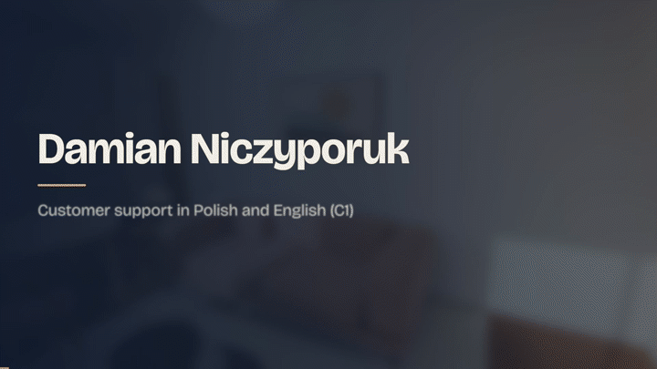
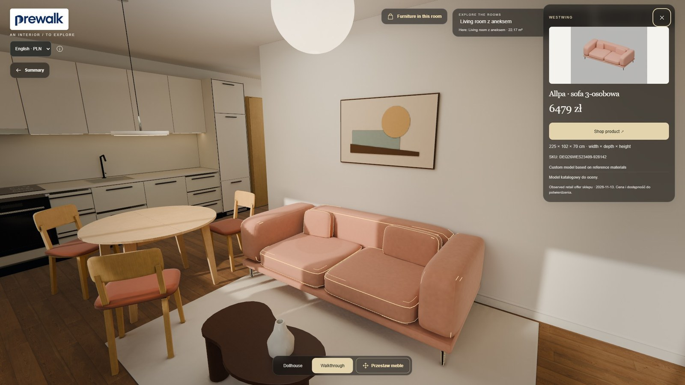

# Damian Niczyporuk

**Customer support in Polish and English (C1) · Hands-on with AI tools and product testing**

[Polski](README.pl.md)

Since 2026 I have been building two products with AI coding agents and running them myself: [Prewalk](https://prewalk.app), a live website for a service that turns floor plans into 3D walkthroughs, and Jarvis, my personal AI assistant.

I am looking for a long-term, fully remote role in customer or technical support, ideally one where I can also work with AI tools, automations and testing.

## One-minute overview

*Click the preview for the full one-minute video (English). The Jarvis call sequence is an illustration with sample data; the real workflow was tested on 13 November 2026 with a synthetic order.*

## Projects

### [Prewalk: from a floor plan to a furnished 3D walkthrough](projects/prewalk/README.md)

A live website in Polish and English, with offers for individuals and businesses and an enquiry form for uploading a floor plan. I defined the product, tested new versions on my own phone and decided what was ready to publish.

**Key moment:** I rejected a release that had passed all automated checks, because the first scroll stuttered on a real phone. [Read the case](quality/prewalk-release-acceptance.md)

### [Jarvis: a personal AI assistant](projects/jarvis/README.md)

A dashboard, a Telegram bot and voice conversations for my daily briefing, tasks and projects. When a Prewalk enquiry arrives by email, Jarvis recognises it and calls me on Telegram. I decided what the assistant may do on its own and what needs my approval, and I tested it on my phone.

**Key moment:** a request to add a task got a reply, but no task appeared in Trello. I reported it and checked the fix in Trello itself. [Read the case](quality/jarvis-task-bug.md)

## How I work with AI

I do not write the code myself. I work as the product owner and tester: I decide what the tool should do, give AI coding agents (such as Codex and Claude) specific tasks, use each version in real conditions, report what does not work and accept or reject the result.

## What I bring to a support team

- Clear communication with customers in Polish and English, including in fast, live situations.
- Describing a problem so that a technical person can act on it: what happened, where, on which device, and what I already ruled out.
- Checking a fix where the customer would see it: on a real phone, in the connected tool, not only in a test report.
- Fast responses: I set up my own tools so that a customer enquiry reaches me by phone.
- Learning new tools quickly. I use AI agents, Telegram, Trello, n8n, Canva and Google and Microsoft tools.

---

Source code, internal instructions and customer data are not part of this portfolio. My CV is available on request.
