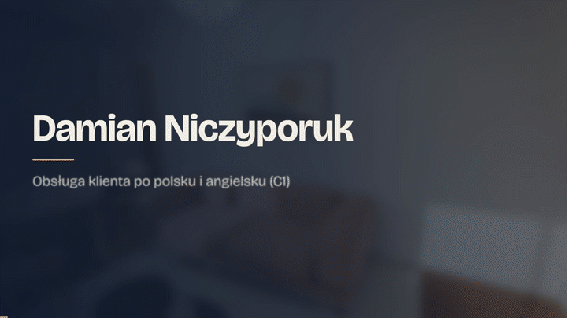
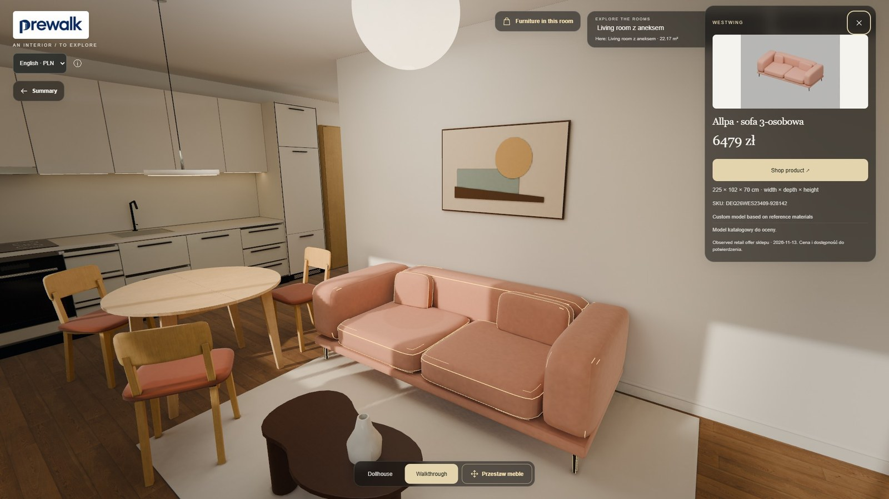

# Damian Niczyporuk

**Obsługa klienta po polsku i angielsku (C1) · Praktyczna praca z narzędziami AI i testowaniem produktów**

[English](README.md)

Od 2026 roku tworzę z pomocą agentów AI dwa produkty i sam je prowadzę: [Prewalk](https://prewalk.app), działającą stronę usługi zamieniającej rzuty mieszkań w spacery 3D, oraz Jarvisa, mojego osobistego asystenta AI.

Szukam długoterminowej pracy w pełni zdalnej w obsłudze klienta lub wsparciu technicznym, najlepiej takiej, w której będę też pracować z narzędziami AI, automatyzacjami i testowaniem.

## Minuta o mnie

*Kliknij podgląd, aby obejrzeć pełne, minutowe wideo. Sekwencja z telefonem od Jarvisa to ilustracja z przykładowymi danymi; prawdziwy przepływ przetestowałem 13 listopada 2026 na sztucznym zamówieniu.*

## Projekty

### [Prewalk: od rzutu mieszkania do umeblowanego spaceru 3D](projects/prewalk/README.pl.md)

Działająca strona po polsku i angielsku, z ofertą dla osób prywatnych i firm oraz formularzem do przesłania rzutu. Określiłem produkt, testowałem nowe wersje na własnym telefonie i decydowałem, co jest gotowe do publikacji.

**Kluczowy moment:** odrzuciłem wersję, która przeszła wszystkie testy automatyczne, bo na prawdziwym telefonie pierwsze przewinięcie strony się zacinało. [Zobacz opis](quality/prewalk-release-acceptance.pl.md)

### [Jarvis: osobisty asystent AI](projects/jarvis/README.pl.md)

Dashboard, bot w Telegramie i rozmowy głosowe do briefingu dnia, zadań i projektów. Gdy mailem przychodzi zapytanie z Prewalk, Jarvis je rozpoznaje i dzwoni do mnie przez Telegram. Zdecydowałem, co asystent może robić sam, a co wymaga mojej zgody, i testowałem go na telefonie.

**Kluczowy moment:** prośba o dodanie zadania dostała odpowiedź, ale w Trello nie pojawiła się karta. Zgłosiłem problem i sprawdziłem poprawkę bezpośrednio w Trello. [Zobacz opis](quality/jarvis-task-bug.pl.md)

## Jak pracuję z AI

Nie piszę kodu samodzielnie. Pracuję jako właściciel produktu i tester: decyduję, co narzędzie ma robić, zlecam agentom AI (np. Codex i Claude) konkretne zadania, używam każdej wersji w realnych warunkach, zgłaszam, co nie działa, i akceptuję albo odrzucam wynik.

## Co wnoszę do zespołu wsparcia

- Jasną komunikację z klientem po polsku i angielsku, także w szybkich sytuacjach na żywo.
- Opis problemu, z którym osoba techniczna może od razu pracować: co się stało, gdzie, na jakim urządzeniu i co już wykluczyłem.
- Sprawdzanie poprawki tam, gdzie zobaczy ją klient: na prawdziwym telefonie i w połączonym narzędziu, a nie tylko w raporcie z testów.
- Szybką reakcję: zbudowałem sobie narzędzia tak, by zapytanie klienta docierało do mnie telefonicznie.
- Szybką naukę nowych narzędzi. Korzystam z agentów AI, Telegrama, Trello, n8n, Canvy oraz narzędzi Google i Microsoft.

---

Portfolio nie zawiera kodu, wewnętrznych instrukcji ani danych klientów. CV udostępniam na prośbę.
