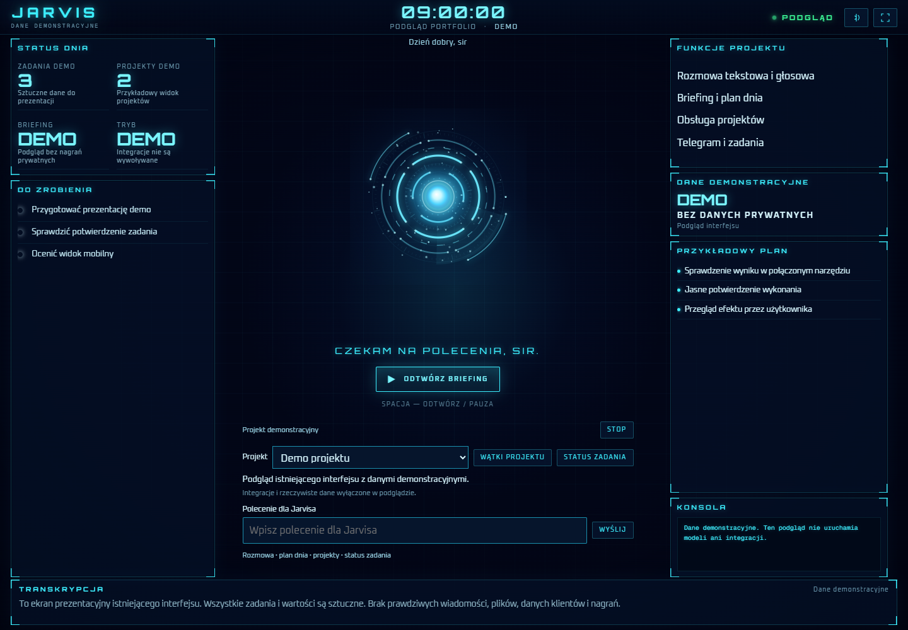

# Jarvis: a personal AI assistant

[Polski](README.pl.md) · [Portfolio](../../README.md)

Jarvis brings my daily briefing, tasks and project updates into one place: a dashboard on my computer, plus a Telegram bot and voice conversations on my phone. I created it with AI coding agents.

*The Jarvis dashboard filled with demonstration data. The interface is in Polish.*

## What it does

- Plays a daily audio briefing in the morning and in the evening.
- Talks by text or voice on the computer, through Telegram messages and voice notes, and in phone conversations.
- Manages tasks in Trello: adds a task, reads today's plan and marks a task as done, also by voice.
- Alerts me about customer enquiries: when a Prewalk enquiry arrives by email, Jarvis recognises it, calls me on Telegram and sends a summary.
- Passes work to AI coding agents and reports progress on my projects.

## My role

- **Features and rules.** I decided what the assistant should do and what it may do on its own. Changes to files need my explicit approval, it cannot send emails or messages on my behalf, and phone access is private.
- **Testing on a real phone.** I confirmed that login, the briefing and voice conversation worked on my phone. I added and completed a test task through Telegram and by phone, and checked that the completed task no longer appeared in the next daily plan. I also tested the enquiry alert with a synthetic order: the call came through and the summary arrived in Telegram.
- **Reporting problems from use.** For example, a request to add a task got a reply but no card in Trello ([full case](../../quality/jarvis-task-bug.md)). In phone tests, speech recognition misheard the project name "Prewalk" in several ways; I confirmed which variants occurred so they could be matched to the right project.

## What the AI agents did

They wrote the code, connected the services, wrote and ran the automated tests and investigated the problems I reported.

Code, internal instructions, account details and private data are not part of this portfolio.
