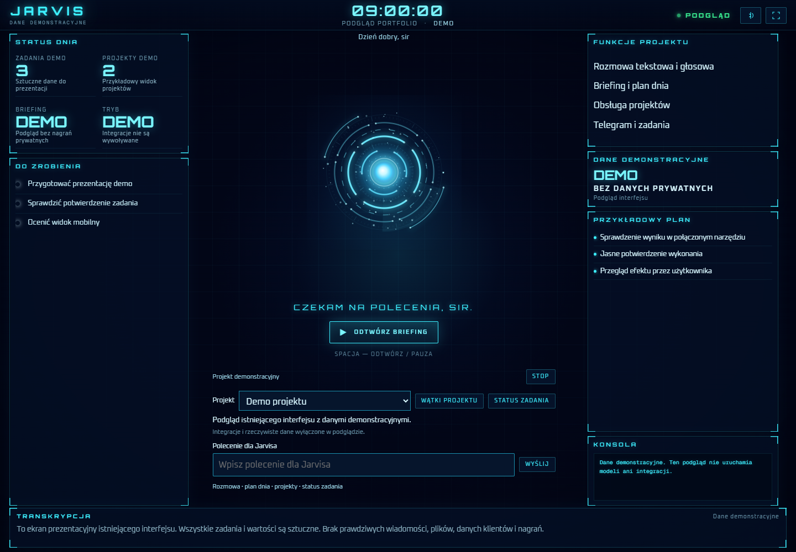

# Jarvis: osobisty asystent AI

[English](README.md) · [Portfolio](../../README.pl.md)

Jarvis zbiera w jednym miejscu mój briefing dnia, zadania i postępy w projektach: dashboard na komputerze oraz bot w Telegramie i rozmowy głosowe na telefonie. Stworzyłem go z pomocą agentów AI.

*Dashboard Jarvisa wypełniony danymi demonstracyjnymi.*

## Co robi

- Odtwarza codzienny briefing audio rano i wieczorem.
- Rozmawia tekstem lub głosem na komputerze, przez wiadomości i notatki głosowe w Telegramie oraz w rozmowach telefonicznych.
- Obsługuje zadania w Trello: dodaje zadanie, odczytuje plan dnia i oznacza zadanie jako zrobione, także głosowo.
- Powiadamia mnie o zapytaniach klientów: gdy mailem przychodzi zapytanie z Prewalk, Jarvis je rozpoznaje, dzwoni do mnie przez Telegram i wysyła podsumowanie.
- Przekazuje pracę agentom AI i raportuje postępy w moich projektach.

## Mój wkład

- **Funkcje i zasady.** Zdecydowałem, co asystent ma robić i co może robić samodzielnie. Zmiany w plikach wymagają mojej wyraźnej zgody, asystent nie może wysyłać maili ani wiadomości w moim imieniu, a dostęp z telefonu jest prywatny.
- **Testy na prawdziwym telefonie.** Potwierdziłem, że logowanie, briefing i rozmowa głosowa działają na moim telefonie. Dodałem i zamknąłem testowe zadanie przez Telegram i przez telefon oraz sprawdziłem, że zamknięte zadanie nie pojawia się w kolejnym planie dnia. Przetestowałem też alarm o zapytaniu na sztucznym zamówieniu: połączenie dotarło, a podsumowanie pojawiło się w Telegramie.
- **Zgłaszanie problemów z użycia.** Na przykład prośba o dodanie zadania dostała odpowiedź, ale w Trello nie powstała karta ([pełny opis](../../quality/jarvis-task-bug.pl.md)). W testach telefonicznych rozpoznawanie mowy przekręcało nazwę projektu „Prewalk” na kilka sposobów; potwierdziłem, które warianty występują, żeby można je było przypisać do właściwego projektu.

## Co zrobiły agenty AI

Napisały kod, połączyły usługi, przygotowały i uruchamiały testy automatyczne oraz diagnozowały zgłoszone przeze mnie problemy.

Portfolio nie zawiera kodu, wewnętrznych instrukcji, danych kont ani danych prywatnych.
