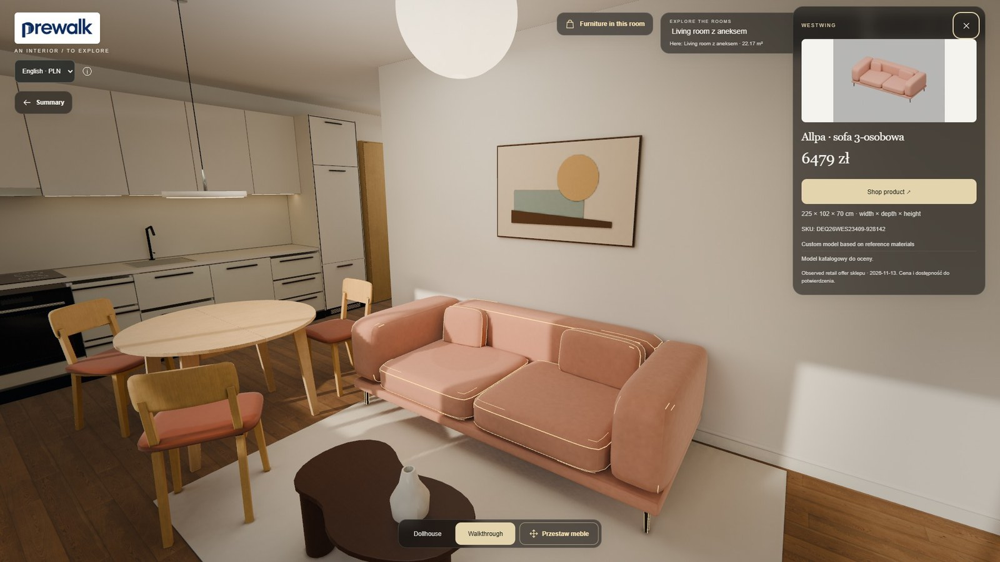
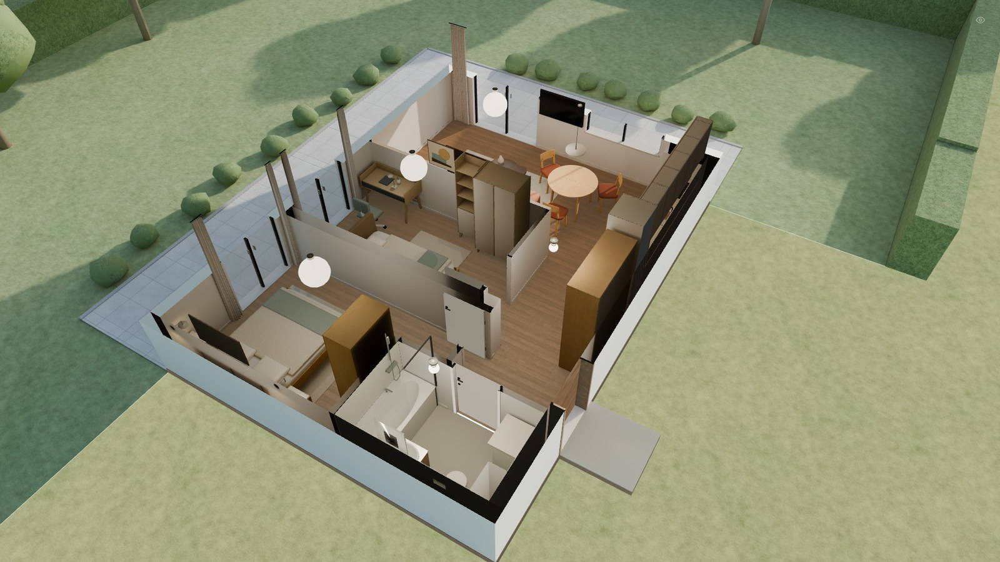

# Prewalk: from a floor plan to a furnished 3D walkthrough

[Polski](README.pl.md) · [Portfolio](../../README.md)

Prewalk turns the floor plan of a flat or house into a furnished 3D walkthrough that you can explore on a phone, with the name, size and price of each piece of furniture. I created the product with AI coding agents and run its public website in Polish and English: [prewalk.app](https://prewalk.app).

*Demo walkthrough of a 55.75 m² flat (cinematic version), recorded in the browser in November 2026, with a furniture card open.*

*The same flat in the dollhouse view.*

**Video:** [short overview for architects and developers](../../assets/prewalk-b2b-en.mp4)

## What exists

- A public website in Polish and English, with separate offers for individuals and businesses, prices in PLN and USD, FAQ and legal pages.
- An enquiry form for uploading a floor plan as a photo or PDF.
- Interactive 3D walkthroughs built from floor plans, including offline versions for presentations.

## My role

- **Product and offer.** I defined who the service is for and what the customer receives. Before launch I narrowed the website to Polish and English and removed a planned launch discount.
- **Release acceptance.** I tested new versions on my own phone (Pixel 9) and in several browsers, and decided whether a version was ready. One of those decisions is described in [this case](../../quality/prewalk-release-acceptance.md).
- **Walkthrough reviews.** I reported visible problems in the walkthroughs: movement, loading, furniture placement and the view through the windows.
- **Website feedback.** I asked for a visible "For businesses" link and for a comparison that was hard to read on a phone to be fixed. I rejected a first hero illustration because it did not show what the service starts from; the final version uses a real floor plan.
- **End-to-end check.** I confirmed a real test of the enquiry form: the email arrived and the uploaded PDF could be downloaded.

## What the AI agents did

They wrote the code and the automated tests, published the website, investigated the problems I reported and documented each release.

## Status

The website is live and open for enquiries. The walkthrough production process is still being developed.

Code, production instructions, 3D models and customer files are not part of this portfolio.
