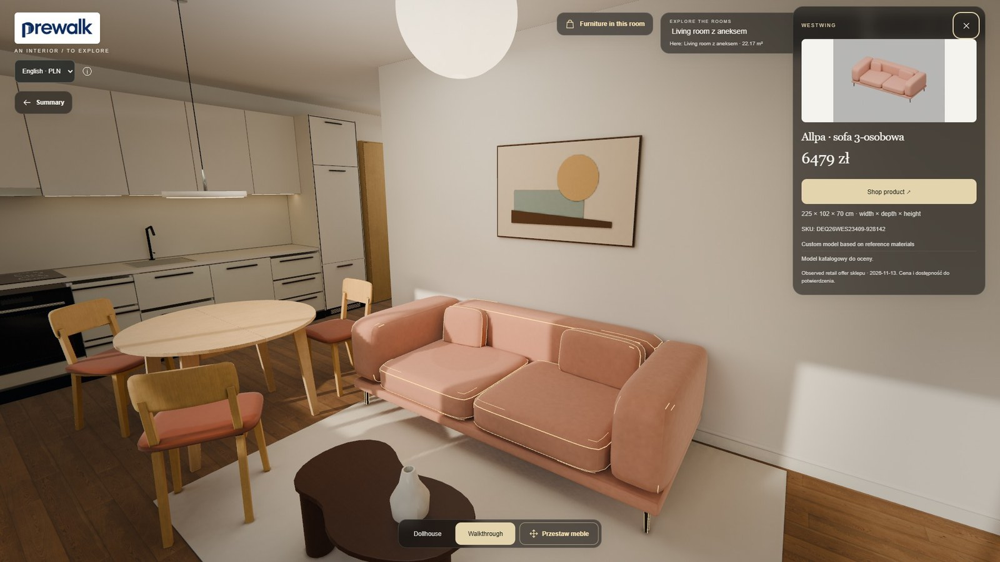
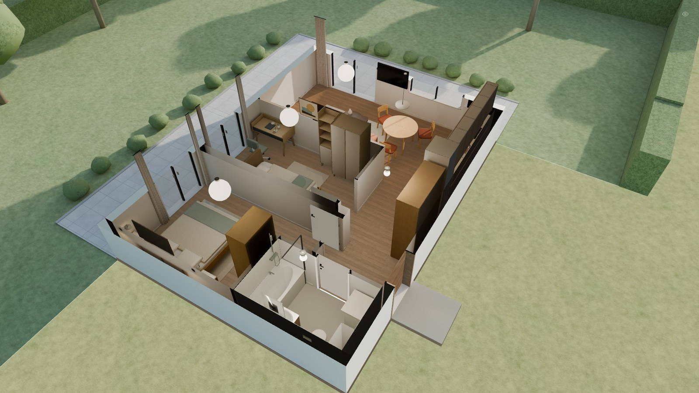

# Prewalk: od rzutu mieszkania do umeblowanego spaceru 3D

[English](README.md) · [Portfolio](../../README.pl.md)

Prewalk zamienia rzut mieszkania lub domu w umeblowany spacer 3D, który można obejrzeć na telefonie, z nazwą, wymiarami i ceną każdego mebla. Produkt stworzyłem z pomocą agentów AI i prowadzę jego publiczną stronę po polsku i angielsku: [prewalk.app](https://prewalk.app).

*Demonstracyjny spacer po mieszkaniu 55,75 m² (wersja cinematic), nagrany w przeglądarce w listopadzie 2026, z otwartą kartą mebla.*

*To samo mieszkanie w widoku makiety.*

**Wideo:** [krótka prezentacja dla architektów i deweloperów](../../assets/prewalk-b2b-pl.mp4)

## Co powstało

- Publiczna strona po polsku i angielsku, z osobną ofertą dla osób prywatnych i firm, cenami w PLN i USD, FAQ i dokumentami prawnymi.
- Formularz zapytania z przesłaniem rzutu jako zdjęcia lub PDF.
- Interaktywne spacery 3D z rzutów, także w wersjach offline do prezentacji.

## Mój wkład

- **Produkt i oferta.** Określiłem, dla kogo jest usługa i co otrzymuje klient. Przed startem ograniczyłem stronę do polskiego i angielskiego oraz usunąłem planowaną zniżkę na start.
- **Odbiór wersji.** Testowałem nowe wersje na własnym telefonie (Pixel 9) i w kilku przeglądarkach i decydowałem, czy wersja jest gotowa. Jedną z tych decyzji opisuje [ten przykład](../../quality/prewalk-release-acceptance.pl.md).
- **Przegląd spacerów.** Zgłaszałem widoczne problemy w spacerach: poruszanie się, ładowanie, ustawienie mebli i widok za oknami.
- **Uwagi do strony.** Poprosiłem o widoczny link „Dla firm” i poprawę porównania, które było nieczytelne na telefonie. Odrzuciłem pierwszą ilustrację na górze strony, bo nie pokazywała, od czego zaczyna się usługa; ostateczna wersja wykorzystuje prawdziwy rzut.
- **Sprawdzenie całej ścieżki.** Potwierdziłem prawdziwy test formularza: e-mail dotarł, a przesłany PDF dało się pobrać.

## Co zrobiły agenty AI

Napisały kod i testy automatyczne, opublikowały stronę, diagnozowały zgłoszone przeze mnie problemy i dokumentowały każdą wersję.

## Stan

Strona działa i przyjmuje zapytania. Proces przygotowania spacerów jest nadal rozwijany.

Portfolio nie zawiera kodu, instrukcji produkcji, modeli 3D ani plików klientów.
